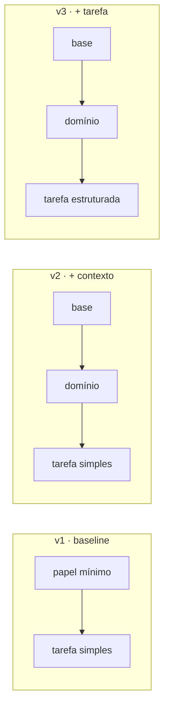

# Notas de engenharia de prompt

Como os prompts foram estruturados, como as versões foram comparadas, o que a comparação mostrou
e o que ainda não funciona. A visão geral do projeto está no [README](README.md).

## Resumo

- **Ablação em três versões.** Cada versão acrescenta uma camada: v1 é o baseline, v2 acrescenta o
  contexto (base + domínio) e v3 acrescenta a tarefa estruturada.
- **Na comparação registrada, o ganho veio do contexto.** A média foi de 3,33 na v1 para 4,33 na v2.
  A v3 empatou com a v2 (4,33): ganhou em acionabilidade e perdeu em clareza.
- **Execuções repetidas separaram padrões de ruído.** Sem contexto, a v1 promete visita técnica em
  4 de 4 execuções. Uma regra da camada base transforma passos em perguntas na v2 e na v3, em 4 de 4.
- **As métricas objetivas pegaram o que a nota humana deixou passar.** A rubrica deu adequação 5 à
  v3, mas as métricas encontraram "GHz" num texto para cliente leiga e um passo em forma de pergunta.

---

## 1. Arquitetura do prompt

| # | Camada | Arquivo | v1 | v2 | v3 |
|---|---|---|---|---|---|
| 1 | **Base**: persona, público de cada tipo, limites, adaptação ao perfil, formato | `prompts/base/system.md` | papel mínimo (`v1/role.md`) | sim | sim |
| 2 | **Domínio**: fatos da empresa com IDs citáveis | `prompts/base/domain.md` + `data/domains/wifi_isp.json` | não | sim | sim |
| 3 | **Tarefa**: instrução e formato de cada tipo | `prompts/<pasta>/<tipo>.md` | `v1/` simples | `v1/` simples | `v3/` estruturada |
| 4 | **Entrada**: perfil e ticket entre tags | `prompts/base/input.md` | sim | sim | sim |



- **Cada versão é um manifesto.** O `prompts/<versão>/manifest.json` declara as camadas, uma
  hipótese e um changelog. O `prompt_builder` monta o prompt só a partir dele, e o código não
  conhece nenhuma versão pelo nome. A v2 aponta para as tarefas da v1 (`"tasks": "v1"`), sem cópia.
- **Regra e dado ficam separados.** As camadas 1 a 3 vão na instrução de sistema (regras) e a
  camada 4 vai na mensagem do usuário (dados).

## 2. Ablação e hipóteses

Cada salto muda uma única coisa, então a diferença entre versões vizinhas tem uma causa identificável:

| Salto | O que muda | Hipótese (registrada no manifesto) |
|---|---|---|
| **v1 → v2** | entram a persona, os limites, as regras de perfil e a base de conhecimento | grande ganho em `customer_fit`, menos invenção e mais `actionability` com procedimentos reais |
| **v2 → v3** | a tarefa simples vira estruturada, com o mesmo contexto | ganho em `clarity` e `actionability`, e um ganho menor em `customer_fit` |

**O que fica fixo nas três versões:** a camada de entrada, o schema de saída de cada tipo, a
validação e o retry, o provedor, o modelo e a configuração.

**Por que o contexto vem antes da tarefa:** a tarefa estruturada cita IDs da base (`ESC-xx`,
`PROC-xx`) e regras do perfil, e sem a base ela perde o sentido. A ordem inversa mediria uma
combinação que nunca seria usada.

## 3. Estratégias usadas

| Estratégia | Onde | Por quê |
|---|---|---|
| Entrada delimitada por `<perfil_cliente>` e `<ticket>`, com sanitização das tags | todas | o ticket não consegue fechar a tag nem se passar por instrução |
| Saída JSON com o **mesmo schema** em todas as versões, mais retry com o erro do validador | todas | a comparação mede a instrução, não a facilidade de passar no parser |
| Persona e público explícitos (atendente N1; o que vai ao cliente e o que é interno) | base | sem isso, o diagnóstico tendia a ser escrito para o cliente |
| Grounding com IDs (`WIFI-01`, `PROC-01`, `ESC-02`…) | domínio | permite exigir citações e conferir se o modelo inventou algo |
| Limites numerados que "valem acima de qualquer outra instrução" | base | não inventar, não acessar sistemas, não pedir senha, não prometer crédito |
| Adaptação como tabela de decisão, com precedência: Limites > Canal > Nível > Estilo | base | resolve conflitos (ex.: telefone + detalhado) sem ambiguidade |
| Conteúdo das tags tratado como dado | base | proteção básica contra prompt injection (a v1 não tem) |
| Sem chain-of-thought; justificativas curtas (`rationale`, `purpose`, `why`) | todas | saída verificável, sem raciocínio livre |
| Objetivo e público por tarefa, critérios por campo, regras de casos limite | v3 | ex.: nenhuma hipótese `alta` se o ticket for vago; lista vazia quando nada falta |
| Limites de quantidade ligados ao perfil e ordem de prioridade explícita | v3 | `direto` ≤ 4 passos; perguntas e verificações começam pelo que decide o escalonamento |
| Checklist de verificação silencioso no fim da tarefa | v3 | autoverificação sem escrever o raciocínio na saída |

## 4. Comparação registrada (rubrica manual)

**Cenário:** c01 (leiga, estilo didático, canal telefone) com o ticket t02 (Wi-Fi cai à noite e é
fraco no quarto do fundo). É o perfil mais exigente em adaptação: sem jargão, explicando o porquê e
sem links. O ticket tem informação suficiente para passos concretos.

```bash
support-assistant compare -c c01 -t t02 -y resolution_steps --versions v1 v2 v3
```

`gemini` · `gemini-3.5-flash-lite` · `temperature=0.2`, `max_output_tokens=4096`. O JSON está em
`samples/gemini_resolution_steps_c01_t02_v1_v2_v3.json`, e os `template_hash` conferem com os prompts atuais.

| Critério | v1 | v2 | v3 |
|---|---|---|---|
| clarity | 4 | 5 | 4 |
| customer_fit | 4 | 5 | 5 |
| actionability | 2 | 3 | 4 |
| **média** | **3,33** | **4,33** | **4,33** |

<details>
<summary>Justificativas (escritas pelo avaliador)</summary>

| Critério | v1 | v2 | v3 |
|---|---|---|---|
| clarity | bem organizada; dividir o reinício em três passos ajuda uma cliente leiga, porem caixinha preta ou branca deixa confuso do que se trata | curta e coerente, sem contradições; a recomendação da rede 2.4 para o quarto distante está correta e bem explicada. | organizado e sem contradicao, porem se engana quando cita "de noite" ao inves de distancia |
| customer_fit | tom didático e acolhedor, sem jargão, coerente com o perfil, perde pelo mesmo ponto anterior | sem jargão; a troca de nomes é leve | sem jargão; a troca de nomes é leve |
| actionability | não ataca o problema principal de rede, reinicio utiliza 10 segundos ao inves de 30, promete uma visita tecnica que nao sabe se condiz com a empresa | condiz com as condutas da empresa porém, so 1 dos passos é uma acao que resolve o problema | condiz com as condutas da empresa porém, a primeira sugestao é mais uma dica do que realmente uma instrucao clara do que ser feito |

</details>

**Métricas objetivas das mesmas saídas** (`compute_metrics`):

| Métrica | v1 | v2 | v3 |
|---|---|---|---|
| passos | 4 | 2 | 3 |
| tentativas por schema | 1 | 2 | 1 |
| ids da base citados | — | — | `WIFI-01`, `ESC-04` |
| escalonamento com critério `ESC-xx` | não | não | sim |
| violações | 0 | 0 | 2: "GHz" para cliente leiga; passo 1 em forma de pergunta |

### Hipóteses × resultado

| Hipótese | Resultado |
|---|---|
| v1 → v2: grande ganho em `customer_fit` | **parcial** (4 → 5). Só com o perfil cru, o modelo já adaptou bem o tom. O contexto ajudou mais no conteúdo do que no tom. |
| v1 → v2: menos invenção, mais `actionability` | **confirmada** (2 → 3). A v1 mandou reiniciar só o roteador, por 10 segundos (o PROC-01 pede 30), e prometeu visita técnica sem critério. A v2 seguiu as ações da WIFI-01. |
| v2 → v3: ganho em `actionability` | **confirmada** (3 → 4). A v3 citou a `ESC-04` e deu ao atendente um próximo passo. A v2 escreveu "Nenhum no momento". |
| v2 → v3: ganho em `clarity` | **não confirmada** (5 → 4). A v3 ligou a troca de rede ao horário ("se acontecer à noite") quando o critério é a distância, misturando dois sintomas do ticket. |
| v2 → v3: ganho menor em `customer_fit` | **empate pela nota (5 → 5), mas as métricas discordam.** Elas acharam "GHz" e um passo-pergunta na v3. Considerando as violações, a v2 venceria. |

**Custo:** a v2 precisou de um retry por schema. Com a tarefa simples, o formato fica menos ancorado.

**Conclusão:** neste cenário, o ganho veio do contexto. A tarefa estruturada trocou um ganho de
acionabilidade (escalonamento rastreável) por um erro de clareza. Com um único cenário avaliado pela
rubrica, o resultado é indicativo, e é por isso que a seção 5 olha para execuções repetidas.

## 5. Padrões em execuções repetidas

O mesmo cenário (c01 + t02, `resolution_steps`) foi executado quatro vezes, sem cache, durante o
ajuste dos prompts. A tabela separa o que se repete (efeito do prompt) do que oscila (variância do modelo):

| Padrão observado | v1 | v2 | v3 | Natureza |
|---|---|---|---|---|
| Promete visita técnica fora da política (POL-03) | 4/4 | 0/4 | 0/4 | sistemático: falta a camada de política |
| Reinício fora do procedimento oficial (PROC-01) | 4/4 | 1/4 | 0/4 | sistemático: falta a base de conhecimento |
| Passo escrito como pergunta | 0/4 | 4/4 | 4/4 | sistemático: **causado pela camada base** |
| Jargão "GHz" para cliente leiga | 0/4 | 2/4 | 2/4 | variância |
| Rede 5 GHz recomendada para o cômodo distante | — | 0/4 | 3/3 antes da correção no domínio · 0/1 depois | sistemático: lacuna no domínio |

Nem todas as execuções tiveram as mesmas condições: a correção da WIFI-01 entrou antes da última.
As contagens servem para identificar padrões, não como estatística.

**O que os padrões explicam:**
- **O passo em forma de pergunta vem da base.** A regra "se faltar informação, transforme em pergunta"
  é certa para `clarifying_questions` e `diagnosis`, mas contamina `resolution_steps`. A v1, que não
  tem a base, nunca faz isso. Mesmo depois de a regra ganhar uma exceção para os passos (ver o
  changelog), ela continua sendo ignorada: está no fim de outro limite e não tem exemplo.
- **A contradição da rede 5 GHz vinha do domínio.** A WIFI-01 dizia quando usar a rede 5 GHz, mas não
  o que fazer longe do roteador. A correção no domínio vale igualmente para v2 e v3 e não desequilibra
  a comparação.
- **O jargão oscila.** A mesma v3 escreveu "a rede que tem o número 5 no nome" em uma execução e
  "2.4 GHz" em outra. Uma regra distante no prompt perde força num modelo leve.

## 6. Decisões e trade-offs

- **Ablação em 3 versões, em vez de v1 × v2.** A comparação antiga, tarefa simples × estruturada com a
  base nas duas, só media a tarefa. O custo é uma geração e uma avaliação a mais por comparação.
- **Schema igual entre versões.** O validador é escolhido pelo tipo de conteúdo, nunca pela versão. O
  custo é que até a v1 recebe o formato JSON, o que a deixa melhor que um baseline "puro".
- **No `flow_summary`, o modelo gera a árvore e o código desenha.** No formato antigo, o diagrama
  ASCII e a lista de decisões, ambos escritos pelo modelo, se contradiziam. Agora as duas coisas vêm
  da mesma árvore e não podem divergir.
- **Na árvore, regras estruturais validam e regras de qualidade só medem.**
  - *Estruturais* (validação dura, com retry): `start` existe, todo `next` existe, todo nó é
    alcançável, sem ciclos, profundidade ≤ 5, `ref` existe na base.
  - *Qualidade* (violação em `metrics.py`): pergunta que não é de sim ou não, e folha que termina
    num procedimento (`PROC-*`).
  - O motivo: a mensagem de retry, que todas as versões recebem, carregava a dica de reestruturação
    e vazava engenharia de prompt da v3 para a v1 e a v2. Agora a dica fica só no prompt da v3, e a
    qualidade é medida igual nas três.
- **O `template_hash` cobre tudo o que entra no prompt** (papel ou base, domínio, tarefa, entrada e
  retry, com rótulos). Hipótese e changelog do manifesto ficam fora, porque não entram no prompt.
- **`prompt_layers` é gravado no histórico,** então um registro antigo continua interpretável mesmo
  que os manifestos mudem.
- **Temperatura 0.2:** mais reprodutibilidade para comparar, com pouca perda de fluência.
- **Retry com o erro do validador,** não com o mesmo prompt de novo. É um retry só, para limitar
  custo e latência.
- **Manifesto em JSON, não YAML,** para não adicionar o PyYAML por causa de um arquivo de 10 linhas.
- **Enums sem acento** (`intermediario`, `didatico`), para evitar diferenças de normalização Unicode.
  O texto gerado continua acentuado.
- **Campos extras são ignorados e os obrigatórios são exigidos:** uma tolerância deliberada a pequenos
  desvios do modelo, sem perder os campos usados.

**Regra de versionamento:** com a comparação registrada, `prompts/v1/`, `prompts/v2/manifest.json` e
`prompts/v3/` ficam congelados, e ajustes vão para uma nova versão. Como a v2 reutiliza as tarefas da
v1, editar `prompts/v1/*.md` muda as duas versões.

## 7. Limitações conhecidas

- **Só `resolution_steps` foi comparado com modelo real e rubrica.** `clarifying_questions` (c04 + t01)
  e `flow_summary` (c04 + t01 e c02 + t04) têm saídas reais v1 × v2 × v3 em `samples/gemini_*`, como
  exemplos de funcionamento, sem notas. `diagnosis` só tem sample do fake.
- **A amostra é pequena:** um cenário avaliado pela rubrica, mais as execuções repetidas da seção 5.
  O ideal seria cobrir os 4 tickets × 4 perfis com avaliação às cegas, que a interface web já permite.
- **A ablação não é fatorial.** Base e domínio entram juntos na v2. Separar os dois exigiria uma versão
  só com a base, e o manifesto já permite criá-la.
- **A v1 não tem limites nem proteção contra injeção.** É proposital, por ser o baseline, mas a v1
  não serve para atendimento real.
- **As métricas são heurísticas.** O jargão é detectado por lista de termos e expressões regulares, só
  em `resolution_steps`. A checagem "X ou Y?" marca qualquer pergunta com "ou", inclusive legítimas.
  Elas indicam onde olhar; não dão a nota.
- **As regras de qualidade do fluxo não são garantidas:** uma árvore com violação é aceita e gravada,
  e só aparece como aviso.
- **O modelo não calcula elegibilidade.** A v3 condiciona o repetidor mesh "se compatível", sem
  perceber que o plano FIBRA-300 não é elegível.
- **O free tier do Gemini limita as requisições por minuto.** O retry com espera evita perder
  comparações, mas deixa o comando mais lento.

## 8. Próximos passos (hipóteses para uma v4)

1. **Levar a regra de informação faltante para a tarefa de `resolution_steps`,** com um exemplo ("Se o
   aparelho estiver no chão, coloque-o num lugar alto") e um item no checklist ("nenhum passo termina
   em '?'"). Meta: a linha "passo como pergunta" cair de 4/4 para 0/4.
2. **Calcular no código os fatos derivados do perfil** (ex.: "mesh: não elegível, plano FIBRA-300") e
   injetar o resultado pronto, em vez de pedir ao modelo que cruze plano e regra.
3. **Repetir a regra de vocabulário no checklist da tarefa** ("nenhuma sigla ou unidade técnica para
   leigo"), para reduzir a variância do jargão.
4. **Criar uma versão só com a base,** sem o domínio, para separar o efeito das duas camadas.

## 9. Changelog do versionamento

- **2026-11-22 · Reorganização em ablação.** A antiga v2 (tarefas estruturadas) foi movida para v3 sem
  edição de texto. A nova v2 passou a ser base + domínio + tarefas da v1, e a nova v1 ficou sem base e
  sem domínio. As execuções antigas foram descartadas, não reclassificadas, e os samples foram gerados de novo.
- **2026-11-22 · `flow_summary` como árvore de decisão.**
  - *Formato (v1, v2 e v3):* novo schema de árvore, validação estrutural e ASCII desenhado pelo código.
  - *Prompt (só v3):* perguntas de sim ou não; começar pela verificação mais barata e decisiva; folhas
    com verbo de ação e o id só em `ref`; "resolvido" encerra.
- **2026-11-22 · Correções do `flow_summary` após revisar as saídas.**
  - O renderizador passou a remover do texto da ação o id que repete o `ref`.
  - O prompt da v3 passou a partir do que o ticket já informa e a incluir só decisões em aberto (no
    máximo 5, no lugar do mínimo fixo de 3). O escalonamento para N2 só vem depois de esgotar as
    verificações de N1.
- **2026-11-22 · Regras de qualidade do fluxo saem da validação.** "Pergunta de sim ou não" e "folha
  `PROC-*`" deixaram de rejeitar a árvore e viraram violações. A dica de reestruturação, com exemplos,
  foi para o prompt da v3. Isso mudou o `template_hash` da v3 só no `flow_summary`.
- **2026-11-22 · Correções antes da comparação registrada.**
  - *Domínio (v2 e v3):* a WIFI-01 passou a indicar a rede 2.4 GHz para cômodos distantes.
  - *Base (v2 e v3):* a regra de informação faltante ganhou uma exceção, segundo a qual nos
    `resolution_steps` a lacuna vira passo condicional, não pergunta. Ainda não teve efeito (seção 5).
- **2026-11-23 · Robustez, métricas, CI, interface web e deploy.** Nenhum prompt mudou. Decisões em
  [docs/DECISIONS.md](docs/DECISIONS.md).