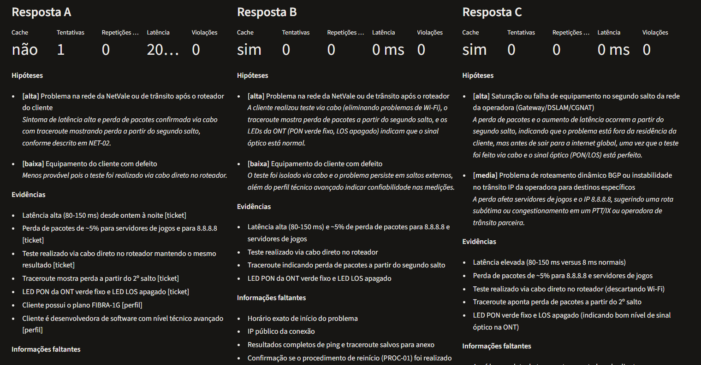
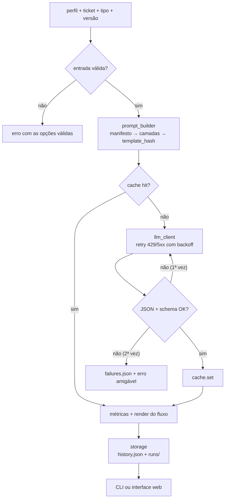

# support-prompt-assistant
 
[](https://github.com/PedroCavalcanti5529/SAC-LLM-Helper-Projeto-V-Lab-/actions/workflows/ci.yml)

[](https://sac-llm-assistant.streamlit.app)
 
**Assistente de suporte técnico que adapta diagnóstico, passos, perguntas e fluxo de decisão ao
perfil de cada cliente, com prompts versionados e comparados de forma controlada.**
 
Python · Gemini · Pydantic · Streamlit · pytest
 

 
_Comparação às cegas: as três versões de prompt aparecem como Resposta A, B e C. A versão real só
é revelada depois que a rubrica é gravada._
 
---
 
## Sobre o projeto
 
Dado um **perfil de cliente** (nível técnico, estilo de comunicação, canal) e um **ticket**, o sistema
gera um de quatro conteúdos para uma empresa fictícia de internet por fibra, a NetVale Fibra:
 
| Tipo | Para quem | O que entrega |
|---|---|---|
| `diagnosis` | atendente | hipóteses, evidências, informações faltantes e conclusão provável |
| `resolution_steps` | cliente | passos adaptados ao nível, ao estilo e ao canal |
| `clarifying_questions` | cliente | só as perguntas necessárias, priorizadas |
| `flow_summary` | atendente | árvore de decisão sim/não, desenhada pelo código |
 
### Problema
 
Uma resposta de suporte genérica falha com quase todo mundo: tem jargão demais para o leigo e
detalhe de menos para o técnico, e links não servem para quem está no telefone. Do lado da
engenharia, prompts costumam virar textos soltos no código, e não há como saber se uma mudança
de prompt melhorou ou piorou a resposta.
 
### Solução
 
- **Prompts em camadas e versionados em arquivos.** Cada versão declara num manifesto quais camadas usa.
- **Ablação v1 → v2 → v3.** Cada versão acrescenta uma camada à anterior, então cada ganho tem uma causa identificável.
- **Saída estruturada e validada.** Schemas Pydantic e uma tentativa de correção com o erro exato do validador.
- **O LLM decide e o código desenha.** O fluxo de decisão vem como uma árvore, e o diagrama é renderizado de forma determinística.
- **Rubrica humana e métricas objetivas lado a lado.** As métricas captam o que a rubrica não mede.
- **Roda sem chave.** O provedor `fake` executa o fluxo inteiro, e é ele que os testes, o CI e a demo pública usam.
---
 
## Como executar
 
Requisitos: Python 3.11+.
 
```bash
python -m venv .venv
source .venv/bin/activate          # Windows: .\.venv\Scripts\Activate.ps1
pip install -r requirements.txt && pip install -e .
cp .env.example .env               # Windows: copy .env.example .env
 
support-assistant generate -c c03 -t t03 -y flow_summary -p v3
```
 
Sem chave, tudo roda com o provedor **fake**, que devolve respostas fixas marcadas com `[FAKE]`.
Para respostas reais, gere uma chave gratuita em <https://aistudio.google.com/apikey> e coloque no `.env`:
 
```env
LLM_PROVIDER=gemini
GEMINI_API_KEY=sua-chave
LLM_MODEL=gemini-3.5-flash-lite
```
 
| Variável | Padrão | Para que serve |
|---|---|---|
| `LLM_PROVIDER` | `fake` | `fake` (offline) ou `gemini` |
| `LLM_TEMPERATURE` · `LLM_MAX_OUTPUT_TOKENS` | `0.2` · `4096` | parâmetros de geração (entram na chave do cache) |
| `LLM_MAX_RETRIES` · `LLM_BACKOFF_BASE_SECONDS` | `3` · `2` | repetição em falha temporária do provedor |
| `OUTPUT_DIR` | `outputs/` | histórico, cache e execuções |
| `APP_PUBLIC_MODE` | `false` | só no deploy público: força o fake e isola o histórico por sessão |
 
---
 
## Uso
 
```bash
support-assistant list                                                       # perfis, tickets e versões
support-assistant generate -c c01 -t t02 -y resolution_steps -p v3          # gerar um conteúdo
support-assistant generate -c c03 --ticket "ping alto desde ontem" -y diagnosis
support-assistant generate -c c04 -t t01 -y clarifying_questions --show-prompt   # só ver o prompt
support-assistant compare  -c c01 -t t02 -y resolution_steps --versions v1 v2 v3
```
 
O `compare` gera a mesma entrada em cada versão, mostra as saídas e as métricas, pede as notas da
rubrica (1 a 5, com justificativa) e grava a comparação em JSON. Toda execução mostra o caminho
do JSON salvo. Repetir um comando idêntico vem do cache, sem chamar a API.
 
Uma saída real (`flow_summary`, v3, cliente intermediário com a luz vermelha acesa na caixinha da fibra):
 
```
Sem internet com luz LOS vermelha piscando
 
[D1] A luz LOS da ONT está vermelha?
├─ SIM → Agendar visita técnica (ESC-01). FIM
└─ NÃO → [D2] O LED PON da ONT está verde fixo após o reinício?
   ├─ SIM → Encerrar atendimento. FIM
   └─ NÃO → Agendar visita técnica (ESC-01). FIM
```
 
### Interface web
 
```bash
pip install -e ".[web]"
streamlit run app/streamlit_app.py
```
 
Tem três telas: **Gerar**, **Comparar** (com avaliação às cegas) e **Histórico**. Elas usam o
mesmo núcleo e o mesmo `outputs/` da CLI. O Streamlit é um extra opcional, então a CLI não depende dele.
 
**Versão online:** <https://sac-llm-assistant.streamlit.app>. O app abre no modo fake, sem cadastro. Para
respostas reais, escolha `gemini` na barra lateral e cole a **sua** chave. Ela fica só na memória
da sessão e nunca é gravada. O histórico também é por sessão.
 
Segurança da chave, isolamento por sessão e como publicar: [docs/DECISIONS.md](docs/DECISIONS.md#4-deploy).
 
---
 
## Arquitetura
 

 
| Módulo | Única responsabilidade |
|---|---|
| `prompt_builder.py` | ler templates e montar o prompt a partir do manifesto |
| `llm_client.py` | acesso à rede (Gemini e fake) |
| `generators.py` | orquestrar validação, cache, retry e persistência |
| `metrics.py` · `flow_render.py` | métricas objetivas · desenho da árvore |
| `cache.py` · `storage.py` | escrita em disco (atômica) |
| `cli.py` · `app/streamlit_app.py` | interação com o usuário, sem lógica própria |
 
Detalhes de cada módulo, schemas, formato do histórico e testes: [docs/ARCHITECTURE.md](docs/ARCHITECTURE.md).
 
---
 
## Prompts e versões
 
O prompt final é montado a partir de quatro camadas:
 
| # | Camada | Conteúdo |
|---|---|---|
| 1 | **Base** | persona, público de cada tipo, limites obrigatórios, regras de adaptação por nível, estilo e canal |
| 2 | **Domínio** | base de conhecimento da empresa, com IDs citáveis (`EQ-01`, `WIFI-01`, `ESC-02`…) |
| 3 | **Tarefa** | instrução e formato de cada tipo de conteúdo |
| 4 | **Entrada** | perfil e ticket delimitados por tags (igual em todas as versões) |
 
As versões formam uma **ablação**:
 
| Versão | Base + domínio | Tarefa | O salto mede |
|---|---|---|---|
| **v1** | não (papel de uma linha) | simples | baseline |
| **v2** | sim | simples (a mesma da v1) | o efeito do **contexto** |
| **v3** | sim | estruturada | o efeito da **tarefa** |
 
Entre as versões, o schema de saída, o modelo, a temperatura e a entrada são sempre os mesmos.
Nenhum prompt está no código Python: todos ficam em `prompts/`, e criar uma v4 é só escrever um
novo `manifest.json`. Estratégias e decisões de prompt: [PROMPT_ENGINEERING_NOTES.md](PROMPT_ENGINEERING_NOTES.md).
 
---
 
## Resultados
 
Comparação de referência em `resolution_steps`. O cenário é a cliente c01 (leiga, estilo didático,
canal telefone) com o ticket t02 (Wi-Fi cai à noite e é fraco no quarto do fundo). Modelo
`gemini-3.5-flash-lite`, temperatura 0.2.
 
| Versão | Clareza | Adequação | Acionabilidade | Média | Violações (métricas) |
|---|---|---|---|---|---|
| v1 | 4 | 4 | 2 | 3,33 | 0 |
| v2 | 5 | 5 | 3 | **4,33** | 0 |
| v3 | 4 | 5 | 4 | **4,33** | 2 (jargão "GHz", passo-pergunta) |
 
Uma rodada isolada esconde muito ruído. Por isso, o mesmo cenário foi executado quatro vezes, e a
tabela abaixo separa o que é **sistemático** do que é **variância**:
 
| Padrão observado | v1 | v2 | v3 | Natureza |
|---|---|---|---|---|
| Promete visita técnica fora da política | 4/4 | 0/4 | 0/4 | sistemático: falta a camada de política |
| Reinício fora do procedimento oficial | 4/4 | 1/4 | 0/4 | sistemático: falta a base de conhecimento |
| Passos escritos como pergunta | 0/4 | 4/4 | 4/4 | sistemático: **causado pela camada base** |
| Jargão (GHz) para cliente leiga | 0/4 | 2/4 | 2/4 | variância |
 
### O que a ablação mostrou
 
1. **O ganho veio do contexto.** Sem a base, a v1 inventa procedimentos e promete o que a política
   não permite, em todas as execuções. Com a base, isso desaparece, e a média sobe de 3,33 para
   4,33. A v3 empatou com a v2: ganhou acionabilidade com um escalonamento rastreável e perdeu
   clareza ao misturar dois sintomas do ticket.
2. **As métricas pegam o que a nota não pega.** A rubrica deu adequação 5 à v3, mas as métricas
   acharam "GHz" num texto para cliente leiga e um passo-pergunta. A rubrica não tem um critério de
   "estar correto", e é por isso que as métricas objetivas existem.
3. **Uma regra global causou um efeito colateral.** O limite "se faltar informação, transforme em
   pergunta" é certo para perguntas e diagnóstico, mas transforma passos em perguntas. A v1, que
   não tem a base, nunca faz isso; a v2 e a v3 fazem sempre. A ablação mostrou de onde o problema vinha.
4. **Uma lacuna no domínio virou um erro consistente.** A base dizia quando usar a rede 5 GHz, mas
   não o que fazer longe do roteador, e a v3 recomendava a rede errada em todas as execuções.
   Corrigido no domínio, o erro sumiu.
5. **Quando o LLM desenhava o diagrama, ele se contradizia.** O diagrama e a lista de decisões
   discordavam. A saída passou a ser uma árvore validada, desenhada pelo código.
Comparações completas, notas com justificativas e limitações: [PROMPT_ENGINEERING_NOTES.md](PROMPT_ENGINEERING_NOTES.md) · exemplos de saída: [samples/](samples/).
 
---
 
## Decisões de engenharia
 
**A versão é um manifesto, não uma cópia.** A v2 reaproveita as tarefas da v1 apontando para elas
no manifesto, sem duplicar arquivos. Assim, a diferença entre as versões fica explícita e auditável.
 
**O hash do template entra na chave do cache.** A chave é o SHA-256 do perfil, do ticket, do tipo,
da versão, do `template_hash` (tudo o que entra no prompt), do provedor, do modelo e da config.
Editar um prompt sem trocar o nome da versão nunca devolve uma resposta antiga.
 
**O LLM gera a estrutura e o código desenha.** No fluxo de decisão, o modelo devolve nós
`{question, yes, no}` e `flow_render.py` desenha a árvore. Diagrama e decisões não podem mais
divergir, a saída gasta menos tokens e a árvore é validável.
 
**Regras estruturais rejeitam; regras de qualidade só registram.** Uma árvore quebrada (ciclo,
nó inalcançável, `ref` inexistente) é rejeitada e entra no retry. Uma árvore ruim (pergunta "X ou
Y?", fluxo que termina num procedimento) vira uma *violação* nas métricas. Se as regras de
qualidade rejeitassem, a v1 e a v2 falhariam e não haveria o que comparar; registrando, a diferença
entre as versões fica mensurável.
 
**O retry de schema traz o erro exato.** A segunda tentativa recebe a mensagem do validador.
Se falhar de novo, as respostas brutas vão para `failures.json` e nada entra no cache nem no histórico.
 
**O retry do provedor é separado do retry de schema.** Só os erros 429, 5xx, timeout e falha de
conexão são repetidos, com espera exponencial e jitter, respeitando o `Retry-After`. Os registros
guardam os dois contadores: `provider_retries` e `attempts`.
 
**As métricas dependem do perfil.** Jargão só é violação para cliente leigo, e URL ou comando só
no canal telefone. As métricas complementam a rubrica, nunca a substituem.
 
**A avaliação é às cegas.** Na interface web, as versões são embaralhadas antes de receberem notas,
o que reduz o viés a favor da versão "nova".
 
**As dependências são mínimas.** O Gemini é chamado via `urllib`, da biblioteca padrão, e o
Streamlit é um extra opcional. As gravações são atômicas (arquivo temporário seguido de
`os.replace`), e o ticket é sanitizado para não fechar as tags do prompt.
 
**A chave é do usuário, nunca do projeto.** O deploy público força o modo fake e aceita uma chave
por sessão, que não vai para disco, histórico, cache nem log.
 
---
 
## Testes
 
```bash
pytest -q
```
 
Todos os testes rodam com o provedor fake, sem rede e sem chave, e o CI os executa a cada push e PR.
 
| Área | O que é garantido |
|---|---|
| Cache | duas gerações idênticas fazem **1** chamada ao LLM; cada versão tem a sua chave |
| Prompts | cada versão gera um prompt diferente; a v1 não contém a base; editar um template muda o hash |
| Validação | retry após JSON inválido; uma falha dupla não grava nada; a rubrica rejeita notas e justificativas inválidas |
| Fluxo | árvores quebradas falham, regras de qualidade viram violações e o renderizador é determinístico |
| Provedor | 503 é repetido até dar certo, 401 nunca é repetido, e as tentativas esgotadas não gravam nada |
| Métricas | as violações dependem do perfil; uma falha nas métricas não derruba a geração |
| Web e deploy | a comparação às cegas só revela as versões depois de gravar; a chave colada nunca é gravada |
 
---
 
## Fora deste recorte
 
- **Mais de um provedor real.** A interface do `llm_client` permite adicionar outros, mas só o Gemini está implementado.
- **Banco de dados e concorrência.** O histórico e o cache são JSON locais.
- **Integração com sistemas reais** (painel de status, cadastro, financeiro). O assistente orienta o atendente a consultá-los.
- **Recuperação por embeddings.** A base é pequena e vai inteira no prompt.
- **Juiz LLM.** As notas da rubrica são humanas.
## Limitações conhecidas
 
- As métricas de adaptação ao perfil são heurísticas (lista de termos e regex) e cobrem só `resolution_steps`.
- Só `resolution_steps` foi comparado com modelo real e rubrica. Os outros tipos têm samples do fake.
- O passo em forma de pergunta ainda aparece na v2 e na v3: a exceção na regra da base existe, mas é ignorada. A próxima hipótese é levar a regra para a tarefa, com exemplo.
- O modelo não calcula elegibilidade (ex.: repetidor mesh por plano). O ideal é calcular no código e injetar o resultado pronto.
- A variância entre execuções do `flash-lite` é alta. As conclusões se apoiam em padrões repetidos, não em uma rodada.
- A proteção contra prompt injection é básica: delimitação, instrução e sanitização das tags.
---
 
## Estrutura do repositório
 
```
├── .github/workflows/ci.yml       # pytest com o provedor fake
├── app/streamlit_app.py           # interface web (extra opcional)
├── data/                          # perfis, tickets e base de conhecimento (domains/)
├── prompts/
│   ├── base/                      # camada base, domínio, entrada e retry
│   ├── v1/ · v2/ · v3/            # manifestos + tarefas
├── src/support_assistant/         # núcleo (ver docs/ARCHITECTURE.md)
├── tests/
├── samples/                       # JSONs de exemplo e comparações avaliadas
├── docs/                          # ARCHITECTURE.md, DECISIONS.md, screenshots/
├── PROMPT_ENGINEERING_NOTES.md
└── CLAUDE.md                      # regras de negócio do projeto
```
 